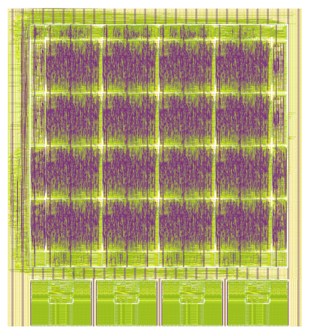

<!---

This file is used to generate your project datasheet. Please fill in the information below and delete any unused
sections.

You can also include images in this folder and reference them in the markdown. Each image must be less than
512 kb in size, and the combined size of all images must be less than 1 MB.
-->

## How it works

Tiny FABulous FPGA (BOAT 26 version).

This design implements a tiny FPGA with 128 LUT4+FF and 4 SRAMs (256x8). The FPGA fabric is 6x6 tiles in size, of which 4x4 are LUT4x8_ha tiles.
The logic cells include a vertical carry-chain in upwards direction, enabling fast additions up to 31-bits (one LC for the start of the carry-chain).

The I/Os resemble the Tiny Tapeout interface and allow for clk, rst_n, uo, ui and uio signals. This makes it possible to implement simple Tiny Tapeout designs directly on the FPGA.

The user design is synthesized using Yosys and implemented using nextpnr. Make sure to use the correct versions or the provided Nix flake.

The bitstream is uploaded to the fabric using a bitbang interface (see how to test). The bitbang interface is active while reset is applied, this ensures that all I/Os are available for the active user design.

The exact available resources can be seen in this table:

| Primitive | Available | Description |
|---|---|---|
| FABULOUS_LC | 128  | Logic cells with LUT4+FF and carry-chain. |
| GF_SRAM_256x8_1RW | 4  | SRAM with 256x8 bits of data and one synchronous read/write port. |
| IOBUF | 26  | Input/output buffers. |
| GBUF | 4  | Global buffers to supply clock, reset and enable to the flip-flops. |
| SYS_RESET | 1 | Can be used to reset the design after configuration. |

Even though there are 26 IOBUF are available, only the uio signals are actually bidirectional. uo will always read zero when read from, and writing to clk, rst_n and ui has no effect.

The GBUFs are used for high-fanout signals. Their use is mandatory for the clock signal of flip-flops to ensure a balanced clock network. This means up to 4 clock domains are possible. The GBUFs can also be used for reset and enable of the FFs, although those can also be routed through "normal" fabric routing.

SYS_RESET applies a reset during fabric reconfiguration and can only be directly connected to a GBUF.

## How to test

First, compile a bitstream for your user design.
The bitstream is big-endian with 32-bit words.

1. Set rst_n to 1 to reset the configuration interface. 
2. Set rst_n to 0 to enable the configuration interface. 
3. Write the bitstream bits to ui[1] (MSB first) and the sample signal on ui[0].

The data is sampled on a rising edge of the sample signal. The interface is synchronous, so ensure that the clk signal is toggling faster than the sample signal.
Is anything is unclear, have a look at the top-level cocotb tests.

Finally, set rst_n to 1 and enjoy your design on Tiny FABulous FPGA!

## External hardware

None
